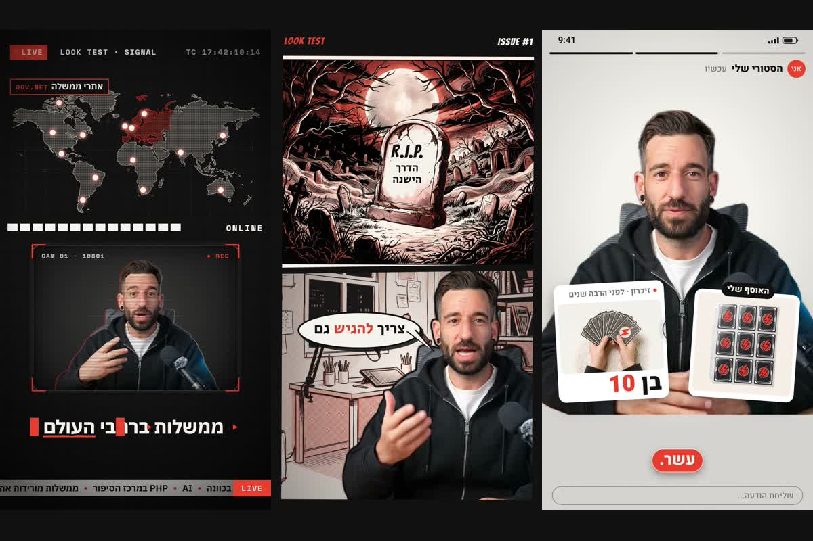

# Twin Reel Studio: a Claude Code skill

**Vertical reels (9:16, 30–100 s) for TikTok, Instagram and Shorts, presented by your own digital twin in your own
voice, inside a full motion-design look.**


*Examples: Guy Aga's twin in the three looks. Your reels star your own twin, in your colours.*

> מקלידים "תעשה לי רילס על…" ומקבלים סרטון 9:16 מוכן לטיקטוק ולאינסטגרם: התאום הדיגיטלי שלכם מ-HeyGen מדבר בקול
> המשובט שלכם, בתוך עיצוב תנועה מלא. גרפיקות יוצאות מתנועות הידיים שלו, כתוביות נדלקות מילה אחרי מילה, ויש עיצוב סאונד
> מלא. שלושה סגנונות: שידור חדשות חי (Signal), חוברת קומיקס (Panels) או מסך טלפון (Feed), בצבעי המותג שלכם ובעברית מלאה.

| Look | The reel is… | Best for |
|---|---|---|
| **Signal** | A live news broadcast: studio monitor, banner, ticker, HUD charts, glitch cuts, typed captions | News, warnings, tech and security stories |
| **Panels** | A comic book: a cover, the camera moving panel to panel, inked art, drawn sound effects, speech bubbles | Opinions, "N signs of", lists, myths, humour |
| **Feed** | A phone screen: a video call, notifications, a live counter, a group chat, a chart that shoots up | Trends, money, numbers, social stories |

Script → your cloned voice → your HeyGen twin on a transparent background → hand tracking (graphics fly out of your real
hand moves) → images in the look's style → a HyperFrames composition with word-by-word captions → a mix balanced
against the voice → a ready-to-post MP4 plus a light copy for WhatsApp.

## Install

Paste into Claude Code:

```
Install the Twin Reel Studio skill: clone https://github.com/guyaga/10d10s-bonus-twin-reel-studio into ~/.claude/skills/twin-reel-studio (git pull there if it already exists). Install any free tool that is missing on this computer (git, Python 3.12, ffmpeg, Node 22) yourself. Then run python -I -X utf8 ~/.claude/skills/twin-reel-studio/scripts/setup.py and follow the skill's "Install and first run" section step by step: talk to me in Hebrew, in plain words, and wait for me after each step. Never ask me to paste an API key into this chat: run creator.py keys so I can paste them into the key file. Don't spend anything (HeyGen, Gemini, ElevenLabs) without asking me first. When setup says READY, run the free selftest and show me the snapshots.
```

Then just ask: *"Make me a 40-second Signal reel about the new Chrome security flaw"*.

## What you need

| | Needed | Notes |
|---|---|---|
| A HeyGen account and **your own avatar** | Required | Avatars → Create avatar. A twin from a short video looks best (it asks for a consent recording); a photo avatar also works. A landscape look is best. |
| `HEYGEN_API_KEY` + money in the **API wallet** | Required | HeyGen → Settings → API. The API wallet is separate from the HeyGen plan: Add funds, $10–15 to start. |
| `GEMINI_API_KEY` | Required | Day 1 of the course (aistudio.google.com/apikey). Billing must be on for images. |
| `ELEVEN_API_KEY` + a voice clone | Recommended | Day 5 of the course. Instant voice clone needs Starter or higher. Much better Hebrew than HeyGen's voice. |
| Python 3.10–3.12, git, ffmpeg, Node 22+ | Installed for you | Claude installs them (winget on Windows, Homebrew on Mac). `setup.py` also downloads the models (about 1.7 GB, once). |
| An image-to-video tool | Optional | Dreamina / Kling / fal / Higgsfield for short animated clips. Without one, the reel skips clips. |

Keys go in `~/.twin-studio/.env` (`creator.py keys` opens it in a text editor) or in environment variables.
`creator.py check` tests every key for free and shows your HeyGen balance.

## What it costs

About **$5–15 per reel**, mostly HeyGen (about $0.12 per second of twin: about $4 for 30 s, $11 for 90 s), plus about
$0.10 per image on Gemini (10–20 images). The skill writes a plan with the price and waits for your OK before it spends.
Rendering runs on your computer: a 90-second reel takes about 6–10 minutes.

## Privacy

Use only your own face and your own voice. Never clone someone else, and don't use the logos or names of real news
outlets in a Signal reel.

## The scripts

| Script | What it does |
|---|---|
| `scripts/setup.py` | one-time install and check: packages, ffmpeg, Node, the models, the profile, the keys; ends with READY or what to fix |
| `scripts/selftest.py` | a free test: a real project with a stand-in figure, built, linted and snapshotted in headless Chrome |
| `scripts/creator.py` | the profile and keys: `keys`, `check`, `looks`, `voices`, `set`, `show` |
| `scripts/new_reel.py` | starts a reel project in a look |
| `scripts/twin.py` | the HeyGen render of your twin |

The profile (`~/.twin-studio/profile.json`) is shared with the `twin-studio` skill: set up once, use both.
